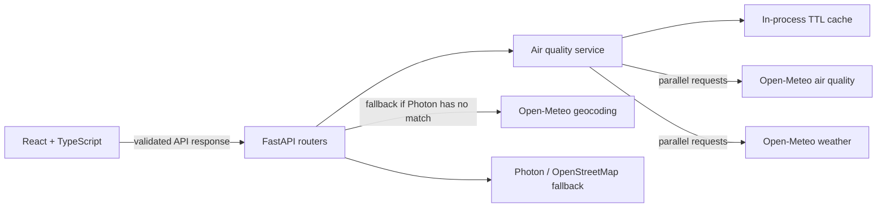

# AirWise AI

AirWise is a responsive urban air quality dashboard and routine planner. It shows modelled AQI and pollutant readings for a selected city, carries the source timestamp through to the screen, and keeps missing or stale data visible.

## What is included

- Worldwide place search for cities, administrative areas, and named places, weather context, pollutant readings, and a 12-hour AQI forecast.
- Browser geolocation and a map link for the currently selected coordinates.
- A local family preference, rule-based daily planning, indoor air guidance, sustainable alternatives, a timing comparison, and a progress checklist.
- Supabase email/password and Google sign-in, with guest mode available until Supabase is configured.
- An optional Gemini-written air-quality summary. The Gemini key stays on the API server; the planner uses a rule-based fallback when it is absent or unavailable.
- Versioned and validated local storage for the selected city and preferences.
- A FastAPI backend that calls fixed Open-Meteo and Photon hosts for location data, validates responses, fetches air and weather in parallel, and caches by rounded coordinates.
- Accessible loading, error, unavailable, and stale states; a forecast data table; reduced-motion support; mobile navigation; visible focus; and a skip link.

Place search uses Photon’s OpenStreetMap-based, worldwide search-as-you-type index and returns up to 20 named places, localities, and addresses. If Photon has no match or is unavailable, the API falls back to Open-Meteo’s worldwide geocoder. Results include available city, state, postcode, and country context; this online search depends on provider coverage and is not a bundled offline gazetteer. Photon’s public service is fair-use and may throttle heavy traffic.

Planner actions remain deterministic. When configured, Gemini writes a short summary from current AQI and forecast numbers; no free text, account details, or family preference is sent to the model. The app uses rule-based summary text when Gemini is not configured or unavailable. Emissions savings are not calculated until sourced factors and user activity inputs are added.

## Architecture



See [docs/ARCHITECTURE.md](docs/ARCHITECTURE.md) for the package map and service boundaries.

## Run locally

Requirements: Python 3.12 or later, Node.js 24, and npm. In Windows Command Prompt, use `cd /d "D:\My Apps\AirWise AI\frontend"` to change both directory and drive.

```powershell
py -3 -m venv .venv
.\.venv\Scripts\Activate.ps1
python -m pip install -e ".[dev]"
Copy-Item .env.example .env
Copy-Item frontend/.env.example frontend/.env.local
uvicorn app.main:app --reload --port 8000
```

In a second terminal:

```powershell
cd "D:\My Apps\AirWise AI\frontend"
npm ci
npm run dev
```

Open `http://localhost:5173`. The Vite development server proxies `/api` and `/health` to port 8000. AQI data and worldwide place search do not require API keys. Gemini and Supabase sign-in need the optional setup below; until then the planner uses rules and the app stays available in guest mode.

### Enable Gemini

Create an API key in Google AI Studio, then add it to the root `.env` file as `APP_GEMINI_API_KEY=...`. FastAPI uses this key; do not put it in a `VITE_*` variable.

### Enable accounts

Create a Supabase project and set `VITE_SUPABASE_URL` and `VITE_SUPABASE_PUBLISHABLE_KEY` in `frontend/.env.local`. Enable email/password in Supabase Auth. For Google sign-in, create a Google OAuth web client, add `http://localhost:5173` as an authorized JavaScript origin, and add `https://<project-ref>.supabase.co/auth/v1/callback` as an authorized redirect URI. Enter its client ID and secret in Supabase Auth → Google. Add `http://localhost:5173/account` to Supabase's Auth redirect URL allowlist. Restart Vite after changing environment variables. The publishable key is intended for browser use; never put a Supabase service-role key in the frontend.

### Start from Windows Command Prompt

Open two Command Prompt windows. In the first, start the API:

```cmd
cd /d "D:\My Apps\AirWise AI"
.venv\Scripts\python.exe -m uvicorn app.main:app --reload --port 8000
```

In the second, start the web app:

```cmd
cd /d "D:\My Apps\AirWise AI\frontend"
npm run dev
```

Open `http://localhost:5173` and leave both windows running.

## Checks

```powershell
python -m ruff check app tests
python -m mypy app
python -m coverage run -m pytest
python -m coverage report --fail-under=90
cd frontend
npm run lint
npm run format:check
npm run typecheck
npm test
npm run build
npm run check:bundle
npm run test:e2e
npm audit --audit-level=high
```

The backend suite also uses `respx` for fixed upstream responses. The CI workflow runs Python and frontend checks, dependency audits, a browser journey, and the initial bundle budget.

## Environment variables

See [.env.example](.env.example). `APP_CORS_ORIGINS` is a comma-separated allowlist. `APP_CACHE_TTL_SECONDS` controls the process-local cache and `APP_MAX_REQUEST_BYTES` caps declared request bodies. `VITE_API_BASE_URL` may point the frontend at the deployed API. Do not put server secrets in a `VITE_*` variable.

## Deployment

### Render API

The included [render.yaml](render.yaml) defines the FastAPI service. Set `APP_CORS_ORIGINS` to the deployed frontend origin in Render’s environment settings. Set `APP_GEMINI_API_KEY` there to enable Gemini summaries. Deploy the repository root; the health endpoint is `/health`.

### Vercel frontend

Create a Vercel project with the root directory set to `frontend`. Build with `npm run build` and output `dist`. Set `VITE_API_BASE_URL`, `VITE_SUPABASE_URL`, and `VITE_SUPABASE_PUBLISHABLE_KEY` in Vercel. Add the deployed account URL to Supabase’s redirect allowlist. Update the Content Security Policy `connect-src` list in [frontend/vercel.json](frontend/vercel.json) to the exact API and Supabase hosts before deploying.

## Data and safety

The air endpoint uses Open-Meteo’s modelled air quality output and preserves its `current.time`. Weather and worldwide place search use Open-Meteo. US AQI category descriptors follow the [US EPA category table](https://www.epa.gov/outdoor-air-quality-data/airdata-basic-information). A displayed forecast is not a station observation. AirWise does not provide medical advice, does not infer indoor air from outdoor readings, and does not treat emissions avoided as personal exposure reduced. See [docs/METHODOLOGY.md](docs/METHODOLOGY.md).

## Requirement traceability

| Requirement | Implementation | Verification |
|---|---|---|
| Worldwide place search, browser location, and map link | `frontend/src/components/Topbar.tsx`, `app/api/routers/places.py`, `app/clients/photon.py` | `frontend/e2e/airwise.spec.ts`, `tests/test_routes.py` |
| Source timestamp, missing and stale readings | `app/services/air_quality.py`, `frontend/src/features/dashboard/DashboardPage.tsx` | `tests/test_air_quality_service.py`, `frontend/src/app/App.test.tsx` |
| AQI categories and deterministic safety guidance | `app/domain/factors.py`, `app/domain/safety.py`, `frontend/src/features/planner/rules.ts` | `tests/test_safety.py`, `frontend/src/features/planner/rules.test.ts` |
| Family preferences and validated local storage | `frontend/src/lib/preferences.ts`, `frontend/src/app/locationStorage.ts` | `frontend/src/lib/preferences.test.ts`, `frontend/e2e/airwise.spec.ts` |
| Indoor-data limits and filtration guidance | `frontend/src/features/indoor/IndoorPage.tsx` | `frontend/e2e/airwise.spec.ts` |
| Emissions and exposure remain distinct | `frontend/src/features/alternatives/AlternativesPage.tsx`, `frontend/src/features/progress/ProgressPage.tsx` | `frontend/e2e/airwise.spec.ts` |
| Fixed upstream hosts, schemas, rate limits, CORS | `app/clients/open_meteo.py`, `app/schemas/air_quality.py`, `app/main.py` | `tests/test_open_meteo.py`, `tests/test_routes.py` |
| Parallel fetch, cache, compression, health | `app/services/air_quality.py`, `app/main.py` | `tests/test_air_quality_service.py`, `tests/test_routes.py` |
| Keyboard and assistive technology support | `frontend/src/app/AppLayout.tsx`, `frontend/src/components/TrendChart.tsx`, `frontend/src/styles/components.css` | `frontend/src/app/App.test.tsx`, `frontend/e2e/airwise.spec.ts` |
| Supabase email and Google sign-in | `frontend/src/auth/`, `frontend/src/features/account/AccountPage.tsx` | `frontend/e2e/airwise.spec.ts` |
| Gemini summary with deterministic fallback | `app/services/planner.py`, `app/api/routers/planner.py`, `frontend/src/features/planner/PlannerPage.tsx` | `tests/test_planner.py`, `frontend/e2e/airwise.spec.ts` |
| Build, typing, lint, audit, and size gates | `.github/workflows/ci.yml`, `frontend/scripts/check-bundle-budget.mjs` | GitHub Actions workflow |

## License and data attribution

Open-Meteo data is used under its published terms. Review the provider’s [API documentation](https://open-meteo.com/en/docs/air-quality-api) and license before public or commercial deployment.
